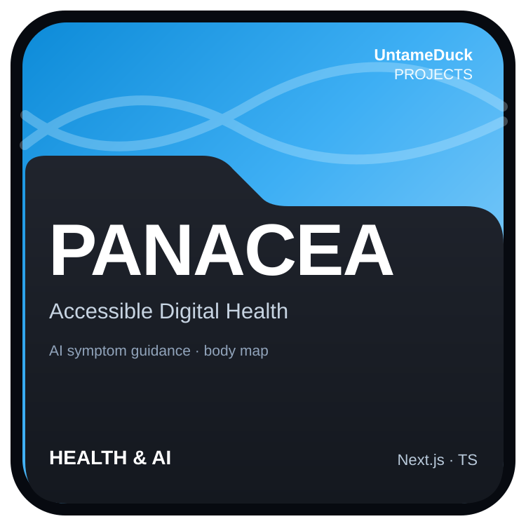
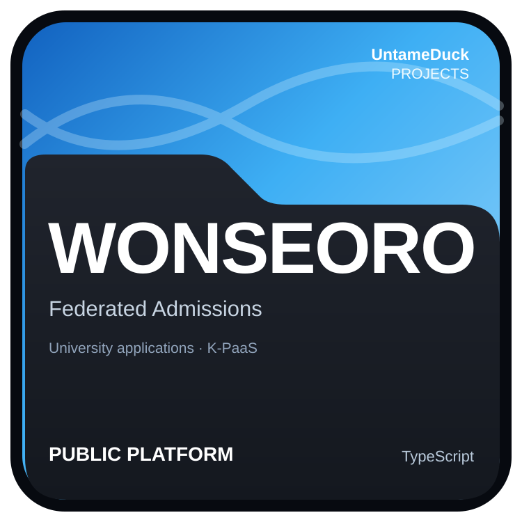
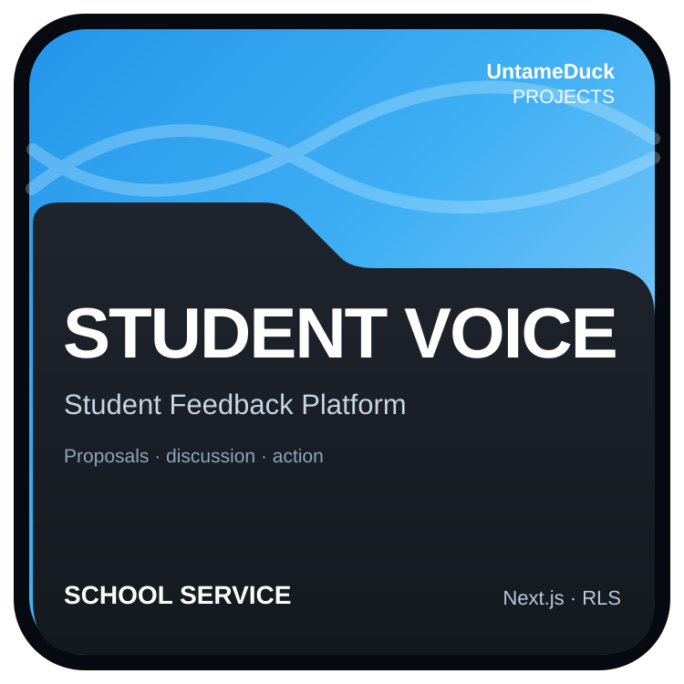
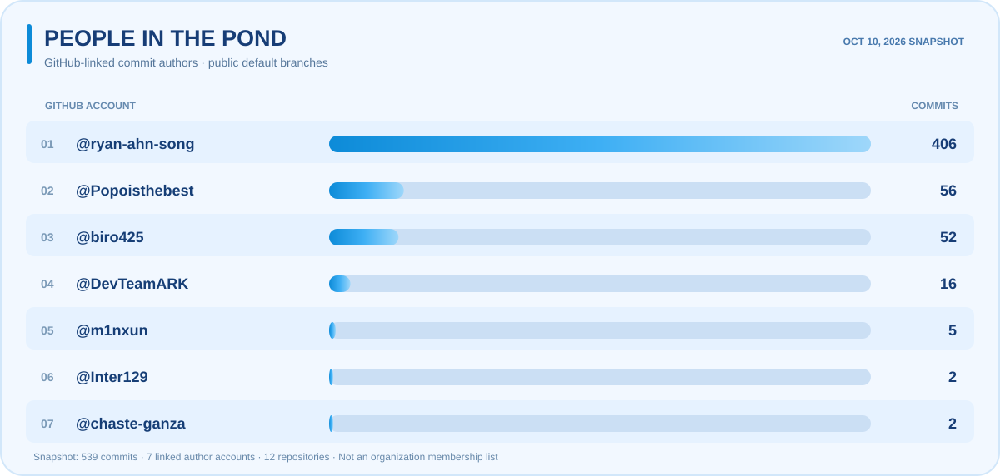

# 🦆 Welcome to my pond!

### UntameDuck — Untamed ideas. Endless ripples.

*A place where curiosity meets code, ideas turn into projects, and every contribution makes a ripple.*

[Explore the Repositories](https://github.com/orgs/UntameDuck/repositories) · [Meet the Projects](#01--about-the-pond) · [Pond Activity](#04--pond-activity)

---

## 01 · About the Pond

**UntameDuck** is a project-driven GitHub organization for ideas that refuse to stay in their lanes. We build useful services for everyday problems, explore AI and security research, and experiment with the systems behind reliable technology.

From student-centered school services to digital healthcare, public platforms, edge computing, and privacy-aware engineering, we enjoy turning curiosity into something real.

> **Make a splash. Leave a ripple.**

### Featured Projects

<table>
  <tr>
    <td width="33%" align="center"></td>
    <td width="33%" align="center"></td>
    <td width="33%" align="center"></td>
  </tr>
</table>

**More projects:** [DSHUB](https://github.com/UntameDuck/Dshub) · [TALOS](https://github.com/UntameDuck/Talos) · [Euterpe](https://github.com/UntameDuck/Euterpe) · [ReNew](https://github.com/UntameDuck/Renew) · [Serene](https://github.com/UntameDuck/Serene) · [Sturun](https://github.com/UntameDuck/Sturun)

## 02 · Tech Stack

Our projects span web development, mobile apps, research prototypes, backend systems, and cloud infrastructure. These technologies represent experience across individual projects, **not a claim that every contributor uses every tool**.

### Languages

  
  
  
  
  
  
  
  
  

### Frontend & Mobile

  
  
  
  
  

### Backend, Data & Cloud

  
  
  
  
  
  
  
  
  

**Research & Engineering Interests:** Applied AI · Computer Vision · Language Models · Digital Signal Processing · Edge & IoT · DPoP · Row-Level Security · K-PaaS

## 03 · Awards & Achievements

<b>2024–2026 · Awards, Competitions & Leadership</b>

| Year | Achievement | Recognition |
| :--- | :--- | :--- |
| **2024** | YEEP Youth Entrepreneurship Competition | **Excellence Award** — Intel Korea Branch President's Award |
| **2025** | Daejeon Metropolitan City Public Data Analysis Competition | **Excellence Award** — Mayor's Award |
| **2025** | YEEP Youth Entrepreneurship Competition | **Excellence Award** — Intel Korea Branch President's Award |
| **2025** | Korea Code Fair Hackathon | **Silver Award** — Director's Award |
| **2025** | White Hat Hacker Competition | **Grand Prize (1st Place)** — University President's Award · [CTF Write-ups](https://github.com/UntameDuck/dju-whitehat-ctf-writeup) |
| **2025** | KERIS Team Competition | **Encouragement Award** — 6th place |
| **2025** | KERIS Individual Competition | **Excellence Award** — 5th place |
| **2025** | Konyang University RISE Entrepreneurship Competition | **Top Excellence Award** — University President's Award |
| **2025** | BizCool Foundation Outstanding Student Selection | Selected as an outstanding student |
| **2025** | Industry–Academia Startup Competition Hackathon | Lead organizer |
| **2025** | Information Security Gifted Education Center | Completed the advanced program |
| **2026** | Industry–Academia Startup Competition Hackathon | Operations advisor and technical mentor |
| **2026** | Hanbat University Junior Entrepreneurship Competition | **Excellence Award** |
| **2026** | e-ICON | **3rd Place** |

*These achievements were provided as part of a member portfolio. They reflect activities of associated individuals or teams, **not necessarily awards granted to UntameDuck itself**. Individual entries have not all been independently verified.*

### Projects in Practice

- **[Student Voice](https://github.com/UntameDuck/Studentvoice)** — A student feedback and proposal service built for everyday school use.
- **[DSHUB](https://github.com/UntameDuck/Dshub)** — School room reservations, facility requests, and operational management.
- **[PANACEA](https://github.com/UntameDuck/Panacea)** — An accessible digital health prototype with AI-assisted symptom guidance and visual interfaces.
- **[Wonseoro](https://github.com/UntameDuck/Wonseoro)** — A K-PaaS-based federated university admissions platform submitted to the 2026 GovTech competition; no prize result is claimed here.

## 04 · Pond Activity

*Every commit, pull request, and contribution sends another ripple across the pond.*

  <a href="https://untameduck.github.io/.github/"><b>🌊 Explore the Interactive Pond Activity Dashboard ↗</b></a>

**Explore 365 days of activity:** hover over any date to see its contribution count, or click to browse public commits and pull requests for that day.

The **Pond Activity** heatmap is designed to aggregate eligible GitHub contributions associated with UntameDuck from discovered public-repository contributors over the past 365 days. Coverage depends on GitHub permissions, contributor visibility, and GitHub's contribution rules.

> **Live data:** The linked interactive dashboard uses GitHub organization-filtered contribution calendars and refreshes daily at 09:23 KST. GitHub Pages must be enabled once under the repository Settings → Pages for the website to become available.

## 05 · People in the Pond

*Big ripples rarely happen alone. Here's to everyone who has helped make them.*

### GitHub Contributors

The leaderboard counts **GitHub-linked commit authors on the default branches of public repositories**. It is **not** an official organization membership list or a complete record of non-code contributions.

<!-- CONTRIBUTORS:START -->
**Updated 2026-10-10 (UTC)** · **539 linked-author commits · 7 author accounts · 12 repositories with commits**

| GitHub Account | Default-Branch Commits | Repositories |
| :--- | ---: | ---: |
| [@ryan-ahn-song](https://github.com/ryan-ahn-song) | 406 | 12 |
| [@Popoisthebest](https://github.com/Popoisthebest) | 56 | 1 |
| [@biro425](https://github.com/biro425) | 52 | 3 |
| [@DevTeamARK](https://github.com/DevTeamARK) | 16 | 1 |
| [@m1nxun](https://github.com/m1nxun) | 5 | 2 |
| [@chaste-ganza](https://github.com/chaste-ganza) | 2 | 1 |
| [@Inter129](https://github.com/Inter129) | 2 | 1 |

<!-- CONTRIBUTORS:END -->

*These are counts of Git commits, not GitHub's contribution-calendar totals. Automated commits, unlinked authors, private repositories, and work outside the default branch may not be represented. A higher commit count is not a measure of someone's overall value.*

### Project Collaborators & Friends

These people have been named in public project documentation or competition coverage. **Being listed does not imply current organization membership.**

| Project or Collaboration | People |
| :--- | :--- |
| [PANACEA / Team ARK](https://github.com/UntameDuck/Panacea#team-ark) | **Kim Sunmin**, **Ryan Ahn Song** · Teacher advisor: Park Jungeun |
| [White Hat Hacker Competition / A.C.T.](https://github.com/UntameDuck/dju-whitehat-ctf-writeup) | **Yoon Jonghong**, **Shin Donggeon**, **Ryan Ahn Song** |
| 2025 Daejeon Public Data Competition | **Kim Taehwan**, **Ryan Ahn Song**, **Kim Sunmin**, **Baek Seungwoo**, **Kwon Minjun** |
| 2025 e-ICON Global Team H6 | **Ryan Ahn Song**, **Kim Sunmin**, **Nishimwe Cynthia Marie**, **Asimwe Landry Chretien Euclide** |

---

### 🌊 Keep making ripples.

**Stay curious. Stay untamed.** 🦆

[Explore All Repositories](https://github.com/orgs/UntameDuck/repositories)

